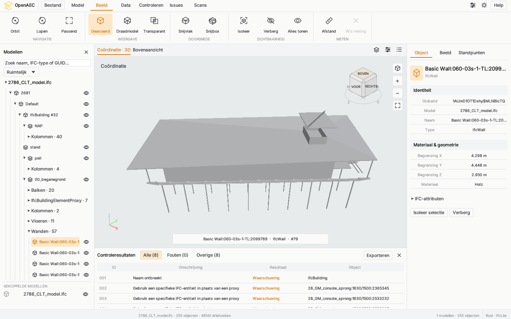
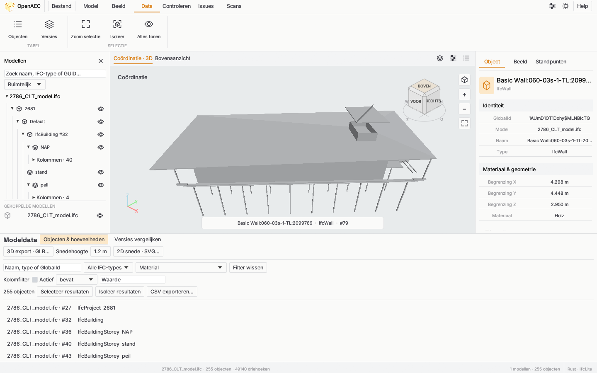
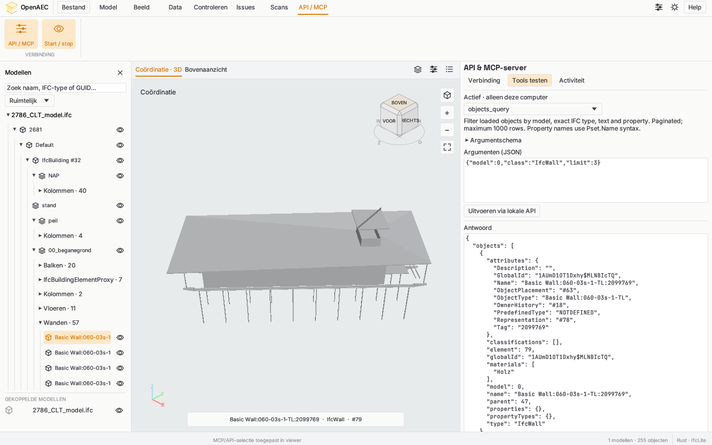

# OpenAEC BIM Validator

Native IFC-viewer en modelcontrole, volledig geschreven in Rust. De desktop-app gebruikt **egui/eframe** voor de interface, **OpenGL** voor 3D-rendering en **IfcLite 20.4.0** voor STEP/IFC-parsing en geometrie. Geen browser, webview, JavaScript- of Python-runtime nodig.

Georeferentie: de importer gebruikt IfcLite RTC-offsets en bewaart wereldorigins in dubbele precisie. Rendering en selectie rekenen relatief aan lokale origins om diepteartefacten bij grote coördinaten te voorkomen.



## Status en richting

Dit is een native desktopversie in ontwikkeling. De werkende functies staan hieronder; de uitbreiding naar de volledige ClashControl- en IfcLite-workflows wordt bijgehouden in het [functieoverzicht en werkplan](docs/FEATURE-PARITY.md). Zie ook de [architectuur](docs/ARCHITECTURE.md). Geplande integraties en voorbeeldextensions worden niet als beschikbare functies gepresenteerd.

## Starten

Installeer een recente stabiele Rust-toolchain en start vanuit de repository:

```sh
cargo run --release --locked
# Direct een model openen:
cargo run --release --locked -- test/2786_CLT_model.ifc
# Zonder venster import en geometrie controleren:
cargo run --release --locked -- --inspect test/fixtures/sample.ifc
```

Linux vereist een grafische desktop, OpenGL 3.3, de X11/Wayland runtimebibliotheken en een desktopportal voor bestandsdialogen. De executable staat na `cargo build --release --locked` in `target/release/openaec-bim-validator` (Windows: `.exe`).

## Werkruimte

De bovenbalk groepeert acties in **Model → Beeld → Data → Controleren → Issues → Scans → API / MCP**. De 3D-weergave, modelboom en inspecteur delen één selectie. Data en issues gebruiken een vast onderpaneel; scans staan rechts. De gewone systeemtitelbalk, het Bestand-menu en native bestandsdialogen blijven behouden.


- Meerdere lokale IFC-modellen combineren; import op een achtergrondthread met voortgang en foutmeldingen.
- Ruimtelijke modelboom, groepering op IFC-type, materiaal, classificatie en afgeleide discipline; zoeken op naam, GUID, type of STEP-id.
- 3D-selectie, Ctrl-multiselect, zoom naar selectie, verbergen/isolereren en zichtbaarheid per model/object.
- Orbit, pan, zoom, perspectief/orthografisch en isometrie/boven/voor/rechts.
- Kleuren per IFC-type, monochroom, draadmodel, röntgen en driehoeksranden.
- Doorsnedebox met zes begrenzingen; picking houdt rekening met doorsneden en verborgen objecten.
- Afstanden en vlakke polygonen meten in meters/m²; zichtlijncontrole tussen twee gekozen punten.
- IFC-attributen, propertysets, hoeveelheden, materialen en classificatie inspecteren.
- Objecttabel met type-, tekst- en propertyfilters; numerieke vergelijkingen, selectie/isoleratie en CSV-export.
- Twee geladen modelversies vergelijken op GlobalId: toegevoegd, verwijderd en gewijzigde metadata/meshes; JSON-export.
- Zichtbare meshes exporteren als GLB en horizontale doorsneden als SVG.
- Camera, doorsneden en zichtbaarheid opslaan als standpunt; `.oaec`-projecten verwijzen naar de originele IFC-bestanden.
- Configureerbare modelkwaliteitscontroles met een auditbare score, en een gedeeltelijke IDS-evaluator met XML-editor; bevindingen zijn aanklikbaar in 3D.
- Native IfcLite-clashcontrole op zichtbare meshes, met model-/typefilters, harde botsingen en minimumafstandregels; regels worden met het project opgeslagen.
- Issuebeheer met vaste topic-ID, status, prioriteit, categorie, eigenaar en opmerkingen; herhaalruns behouden de beoordeling.
- BCF 2.1/3.0-import en -export voor beheerde issues, inclusief camera, object-GUIDs, zichtbaarheid, snijvlakken en snapshots.
- JSON-rapportage en lokale projectopslag van resultaten, issues en clashregels.
- Puntenwolken (LAS/LAZ, PLY, PCD, XYZ, PTS, PTX en E57) via de Rust-kern van Open Pointcloud Studio; registratie, ICP, afwijkingsheatmap, hotspotissues en een PDF-overzicht.
- Licht/donker thema en opgeslagen weergavevoorkeuren.

**Bediening:** links slepen draait, rechts/midden slepen verschuift, scroll zoomt. Home toont het model, F zoomt de selectie, H verbergt en I isoleert. Ctrl+O opent IFC, Ctrl+S bewaart het project. Dubbelklik zoomt een object.

## Coördinatie gebruiken

1. Open IFC-modellen via **Bestand → IFC openen**. Gebruik de modelboom voor zichtbaarheid en de inspecteur voor objectgegevens.
2. Kies **Controleren → Clashregels**. Stel groepen A/B in op model en eventueel een exact IFC-type. Kies harde botsingen of vrije ruimte en stel de afstanden in meters in. Zonder B-scope wordt A onderling gecontroleerd.
3. Voer de controle uit en bekijk de resultaten in 3D. Kies **Issues → Uit resultaten** om bevindingen als duurzame issues vast te leggen; bestaande statussen en opmerkingen blijven behouden.
4. Bewerk titel, status, eigenaar en prioriteit in **Issuebeheer**. **Actueel standpunt + snapshot vastleggen** bewaart het huidige beeld bij het topic.
5. Importeer BCF via **Issues → BCF import**. Een bestaand topic met dezelfde GUID wordt behouden. Exporteer naar 2.1 of kies 3.0 in Issuebeheer. Zonder beheerde issues blijft de oorspronkelijke 2.1-export van bevindingen beschikbaar.
6. Sla het `.oaec`-project op om standpunten, issues, resultaten en regels te bewaren. IFC-bestanden blijven losse bestanden en moeten bij heropenen beschikbaar zijn.

**Meten en zichtlijnen:** Afstand kiest twee punten. **Model → Oppervlak** voegt hoekpunten toe aan een vlakke polygoon; kies de punten in volgorde en gebruik Wis meting voor een nieuwe meting. De vlakheidstolerantie is 1 mm. Zichtlijn gebruikt de twee afstandspunten als oogpunt en doel en meldt tussenliggende zichtbare IFC-objecten; het is geen normtoets.

**Lopen:** kies Lopen, klik in de viewport en gebruik W/A/S/D; Q/E beweegt verticaal. Slepen draait de kijkrichting. Orbit schakelt terug. Er is geen botsingsbeperking in loopmodus.

## Scans en afwijkingen

Open **Scans → Puntenwolk openen** of gebruik het Bestand-menu. De parser is de ongewijzigde Rust-library `pointcloud-core` uit Open Pointcloud Studio, vastgezet op commit `13b199a426e692d2149998b3f2f596a191568501`.

- **Puntenwolk in beeld** past de camera op de scan aan.
- Voer drie overeenkomstige punten in meters in: originele scancoördinaten links, IFC-coördinaten rechts. **Registratie toepassen** bepaalt een rigide transformatie zonder schaalverandering.
- **Registratie verfijnen (ICP)** gebruikt circa 5000 punten, maximaal 60 iteraties en alleen correspondenties binnen de ingestelde afwijkingsgrens. Dit vereist een goede beginregistratie.
- **Afstand tot IFC berekenen** meet de kortste afstand tot zichtbare IFC-driehoeken. Groen ligt op het oppervlak; rood bereikt of overschrijdt de ingestelde grens. De afstand heeft geen teken.
- Afwijkende punten worden via aangrenzende cellen van 0,5 m tot clusters samengevoegd. Maak daarvan issues of exporteer een PDF-overzicht met aantallen, maxima en coördinaten.

**Grenzen:** maximaal twee miljoen punten worden ingelezen als steekproef. Zowel weergave als afwijkingscontrole gebruiken die punten; het aantal wordt naast het brontotaal getoond. Dit is nog geen out-of-core verwerking van de volledige scan. De PDF is een tekstoverzicht zonder snapshots per cluster. Projecten bewaren scanpaden en registraties; afwijkingen worden na heropenen opnieuw berekend. Disciplinegroepering is afgeleid van IFC-types, niet van een gecontroleerde disciplineclassificatie.

## Datakwaliteit en IDS

**Controleren → Kwaliteitsregels** voegt materiaal-, classificatie-, NL-SfB-aanwezigheids- en common-propertycontroles toe. De score is het aandeel geslaagde controles op objecten met geometrie; elke controle telt even zwaar. Een lege werkruimte krijgt geen perfecte score. De NL-SfB-controle controleert aanwezigheid, niet de geldigheid van de code in een officiële classificatietabel.

**IDS editor** opent, bewerkt en bewaart IDS-XML. Valideren gebruikt dezelfde gedeeltelijke evaluator als IDS openen. Gebruik de onderstaande beperkingen bij het interpreteren van resultaten.

## OpenAEC-vormgeving

Het [goedgekeurde UI-ontwerp](docs/ui-design-reference.png) is vertaald naar native Rust-controls: een gegroepeerd pictogramlint, compacte modelboom met zichtbaarheidsknoppen, documentbalk, object-/beeld-/standpuntinspecteur en een filterbare resultatentabel onder het 3D-beeld. Het lichte thema is standaard; de zonknop wisselt naar donker. De viewport heeft een camera-afhankelijke oriëntatiekubus met aanklikbare vlakken, randen en hoeken, gebaseerd op de interactie in Open Pointcloud Studio, en zoomknoppen. De gewone systeemtitelbalk blijft behouden; de extra app-titelbalk is verwijderd. Bestand gebruikt een dropdownmenu en native bestandsdialogen. Paneelknoppen in de documentbalk tonen of verbergen de zijpanelen en resultaten.

De voorbeeldarchitectuur in het ontwerpbeeld is geen meegeleverd IFC-model. De app en bovenstaande schermafbeelding tonen echte IFC-geometrie en gegevens. Afstand, vlakke oppervlaktemeting en lokaal issuebeheer zijn geïmplementeerd. Gedeelde projecten en externe connectoren staan nog op het werkplan.

De native lay-out volgt [OpenAEC-style-book](https://github.com/OpenAEC-Foundation/OpenAEC-style-book), commit `dfdcd415b26604081b1699560621d3e9ae7ea6bf`, met name `brandbook/LAYOUTS.md` §3 en de design tokens. De menurij, amberaccenten, panelen en meegeleverde Inter-, Space Grotesk- en JetBrains Mono-fonts worden in Rust getekend. Zie `native/assets/` voor licenties en bronvermelding.

## Validatie en grenzen

Dit is een nieuwe native viewer, **geen volledige Solibri-vervanger**. De geometrieondersteuning volgt IfcLite; geometriefouten en lege tessellaties worden zichtbaar gemeld. IFC2X3/IFC4/IFC4X3 STEP wordt geaccepteerd; IFCZIP en IFCXML worden niet geïmporteerd.

De modelcontrole controleert ontbrekende namen/GUIDs, dubbele GUIDs, proxies en importmeldingen. De IDS-evaluator ondersteunt entity-, attribute-, property-, material- en classification-facetten met eenvoudige waarden, gebruikelijke patronen, enumeraties, numerieke grenzen en cardinaliteit. Niet-ondersteunde facetten/restricties worden expliciet gemeld. Dit is geen gecertificeerde IDS-implementatie: onder meer `partOf`, volledige XML-Schema-regexsemantiek, uitgebreide propertyvarianten en alle overervings-/eenheidsregels ontbreken nog. Gebruik deze versie dus niet om volledige IDS-conformiteit vast te stellen.

Nog niet aanwezig: geavanceerde clashclustering, samenwerking via een server, Revit-koppeling, IFC-bewerking, doorsnedecaps en Solibri-regelsets. BCF verwerkt momenteel één viewpoint per topic; camera-roll en schuine geïmporteerde snijvlakken worden nog niet weergegeven. Meerdere viewpoints, documenten en kleurinstellingen uit externe BCF-bestanden worden niet volledig behouden. Kleurweergave is per IFC-type, niet op de oorspronkelijke IFC-oppervlaktestijl. Doorsneden zijn een weergave-instelling en wijzigen de meshes voor clashcontrole niet. Clashafstanden geven expliciet aan of ze op de mesh gemeten of uit begrenzingen geschat zijn. Er is nog geen benchmarkgarantie voor gigabyte-modellen of georeferenties met zeer grote coördinaten.

## Data en exports

Open **Data → Objecten**. Kies een IFC-type en propertykolom; activeer een kolomfilter voor tekst, aanwezigheid of een numerieke vergelijking. Resultaten zijn te selecteren of isoleren in 3D en te exporteren als CSV. De som telt numerieke bronwaarden zonder eenheidsconversie; controleer zelf dat de eenheden overeenkomen.

Open beide revisies als afzonderlijk IFC-model en kies **Data → Versies**. De vergelijking gebruikt GlobalId, weigert dubbele GUIDs en slaat objecten zonder GUID over. Metadata en driehoeken worden vergeleken; geometrie wordt op een 1 mm raster gelegd. Een gewijzigde triangulatie kan daarom ook een geometrieverschil geven. Dit is geen volumetrische vergelijking.

**Data → GLB** exporteert zichtbare objecten in meters, Y-up, met lokale coördinaten en de IFC-wereldorigin in scene-extras. De export gebruikt typekleuren; viewport-clipping wordt niet in de GLB-geometrie gesneden. **Data → 2D snede** gebruikt de opgegeven absolute Z-hoogte in meters en schrijft driehoek/snijlijnen als SVG, zonder arcering, maatvoering of gesloten contourreconstructie.



## Headless CLI

Dezelfde Rust-binary werkt zonder grafisch venster voor `--inspect`, `--query`, `--validate`, `--diff`, `--glb` en `--section`. Gebruik `--help` voor argumenten. Bijvoorbeeld:

```sh
openaec-bim-validator --query model.ifc IfcWall
openaec-bim-validator --diff oud.ifc nieuw.ifc
openaec-bim-validator --glb model.ifc model.glb
openaec-bim-validator --section model.ifc 1.2 snede.svg
```

JSON gaat naar stdout; importmeldingen naar stderr. `--validate` rapporteert basiskwaliteitsbevindingen en geeft alleen bij uitvoeringsfouten een fout-exitcode; beoordeel bevindingen in het JSON-resultaat. Export weigert bestaande uitvoerbestanden te overschrijven.

## API en MCP, inclusief desktopbeheer

Open **API / MCP** om de lokale server te starten/stoppen, een clientconfiguratie te kopiëren, tools via HTTP te testen en aanroepen te bekijken. Verbonden clients zien de geladen modellen; objectselecties kunnen direct in de viewer worden toegepast.

Dezelfde binary biedt REST/JSON met OpenAPI 3.1, MCP Streamable HTTP en MCP stdio. Tien tools dekken modelinformatie, objectfilters/properties, kwaliteit/IDS, clashes, modelvergelijking, exports en viewerselectie. Alle HTTP-routes gebruiken een token en luisteren alleen op deze computer. De MCP-implementatie gebruikt de officiële Rust-SDK.

```sh
# Headless MCP voor een client die child processes start:
openaec-bim-validator --mcp model.ifc
# REST + MCP HTTP (OPENAEC_API_TOKEN eerst instellen):
openaec-bim-validator --api 19781 model.ifc
```

Zie [API/MCP-handleiding, routes, tools en limieten](docs/API-MCP.md).



## Releases

De huidige versie is **0.3.0-rc.1**. Zie [release-instructies](docs/RELEASE.md), [wijzigingen](release/NOTES.md) en het [LinkedIn-concept](release/LINKEDIN-NL.md). De releaseworkflow bouwt Linux x64, Windows x64 en macOS ARM64/x64. Dat een workflow is opgenomen betekent niet dat alle platformbuilds al zijn uitgevoerd; download alleen artifacts uit een geslaagde run. Ondertekening en notarization vereisen organisatiecertificaten.

## Ontwikkeling

```sh
cargo fmt --all --check
cargo test --workspace --all-features --locked
cargo clippy --workspace --all-features --all-targets --locked -- -D warnings
cargo build --release --locked
python3 scripts/test-native-protocols.py target/release/openaec-bim-validator
```

Visuele smoke-test (echte desktop/OpenGL vereist):

```sh
OPENAEC_SCREENSHOT_TO=/tmp/bim-viewer.png OPENAEC_SCREENSHOT_REVIEW=1 cargo run --features screenshot -- test/2786_CLT_model.ifc
# Andere controlebeelden: OPENAEC_SCREENSHOT_REVIEW=settings, dark, issues, rules, data, scans of mcp
# Kleinere desktop: voeg OPENAEC_SCREENSHOT_COMPACT=1 toe
```

De Rust-bronnen staan in `native/src/`: modelimport, camera/picking, renderer, validatie, issuebeheer, BCF, pointcloudverwerking, rapportage, thema en desktop-UI zijn afzonderlijke modules. `Cargo.lock` legt de afhankelijkheden vast.

De eerdere React/Python-app blijft als migratiereferentie aanwezig in `viewer/`, `server/` en `src/`; deze wordt niet aangeroepen door de native app. De oude installatie- en CLI-documentatie staat in [docs/LEGACY-PYTHON.md](docs/LEGACY-PYTHON.md). De bestaande Dockerconfiguratie behoort tot die eerdere app.
